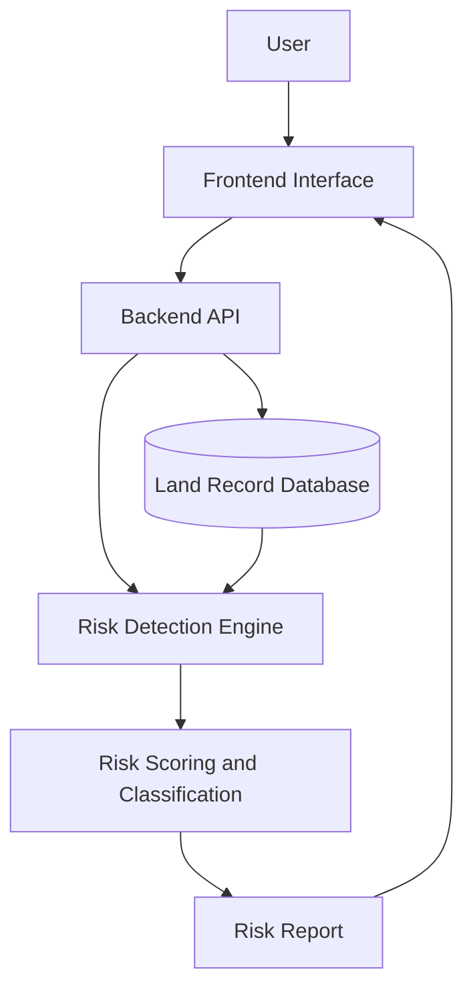

# OBICHOL (অবিচল)

### Land Fraud Detection & Risk Assessment System for Bangladesh

**Making Land Information Safer, One Record at a Time.**

OBICHOL is a proposed land fraud detection and risk assessment system designed to help identify suspicious land-record patterns, potential ownership conflicts, duplicate records, and unusual property-transfer activities in Bangladesh.

The goal is to develop a system that analyzes available land-record information, assigns explainable risk scores, and generates risk reports to support safer and more informed land-related decisions.

> **Project Status:** Concept & Prototype Development
> **Initial Approach:** Rule-Based Risk Assessment
> **Data for Demonstration:** Simulated land records
> **Long-Term Vision:** A scalable, secure, and data-driven land fraud risk assessment platform for Bangladesh.

---

## 1. The Problem

Land-related fraud and disputes can involve conflicting ownership claims, forged or inconsistent documents, duplicate transactions, and suspicious transfer histories. Verifying land information can be complicated, especially when relevant records are difficult to access or compare.

OBICHOL aims to address this challenge by providing a structured way to flag suspicious patterns and communicate potential risks.

The system is intended to **support preliminary risk assessment**, not replace official land-record verification, legal procedures, or professional advice.

## 2. Our Mission

To explore how technology can make land-related information easier to assess, suspicious patterns easier to identify, and potential risks easier to understand.

### Objectives

* Identify potentially suspicious patterns in land-record data.
* Flag duplicate records and conflicting information.
* Calculate explainable risk scores using predefined rules.
* Classify records into Low, Medium, and High risk categories.
* Generate understandable risk reports.
* Explore future integration with authorized, verified land-record sources.
* Build toward a scalable solution that could eventually support broader deployment across Bangladesh.

## 3. Key Features

*The following list describes the planned scope. Features will be marked as implemented as development progresses.*

| Feature                        | Description                                             | Status             |
| ------------------------------ | ------------------------------------------------------- | ------------------ |
| Land Record Assessment         | Analyze submitted record information                    | Planned            |
| Rule-Based Risk Scoring        | Calculate scores using predefined risk indicators       | Proposed           |
| Risk Classification            | Categorize records as Low, Medium, or High risk         | Proposed           |
| Duplicate Record Detection     | Flag possible duplicate entries                         | Planned            |
| Ownership Conflict Detection   | Identify conflicting ownership information              | Planned            |
| Suspicious Transfer Detection  | Flag unusual transfer patterns                          | Planned            |
| Registration Detail Comparison | Identify duplicate or inconsistent registration details | Planned            |
| Risk Report Generation         | Present risk scores and reasons for alerts              | Planned            |
| Search and Filtering           | Search records and filter by risk category              | Planned            |
| Dashboard and Analytics        | Summarize records and risk distributions                | Planned            |
| Audit Trail                    | Maintain a history of assessment activities             | Future Enhancement |
| Access Control                 | Restrict access according to user roles                 | Future Enhancement |
| Machine Learning Integration   | Explore data-driven anomaly detection                   | Future Enhancement |

## 4. Proposed System Architecture

The proposed architecture separates the user interface, application logic, data storage, and risk detection components.

### Component Overview

* **Frontend:** Interface for entering, searching, and reviewing land-record information.
* **Backend API:** Handles requests and coordinates data processing.
* **Database:** Stores permitted record information and demonstration data.
* **Risk Detection Engine:** Evaluates records against defined rules.
* **Risk Scoring and Classification:** Calculates risk scores and assigns risk levels.
* **Risk Report:** Presents flagged issues and explains why a record was marked for review.

*This diagram represents the proposed architecture; the final implementation may evolve during development.*

## 5. Proposed Risk Assessment Methodology

OBICHOL initially proposes a transparent, rule-based scoring model. Each detected indicator contributes points to a record's risk score.

### Initial Proposed Risk Indicators

| Risk Indicator                                | Proposed Score |
| --------------------------------------------- | -------------: |
| Conflicting ownership information             |            +30 |
| Possible duplicate sale or multiple claims    |            +50 |
| Suspiciously frequent property transfers      |            +20 |
| Duplicate or conflicting registration details |            +40 |

### Risk Classification

| Total Risk Score | Risk Level | Suggested Interpretation                                 |
| ---------------- | ---------- | -------------------------------------------------------- |
| 0–29             | Low        | Few predefined risk indicators detected                  |
| 30–59            | Medium     | One or more indicators require further review            |
| 60 or above      | High       | Multiple or significant indicators require closer review |

**Proposed calculation:**

`Risk Score = Sum of the points assigned to detected indicators`

For an initial prototype, the score may be capped at 100. Duplicate detections of the same issue should be handled carefully to avoid unfairly inflating the score.

These scores are initial design choices, not statistically validated probabilities. They will need testing and refinement. A high-risk result is a warning for further verification, not proof of fraud or a legal conclusion about ownership.

## 6. Proposed User Workflow

1. The user submits available land-record details.
2. The system validates the submitted information.
3. The record is compared against available demonstration records.
4. The risk detection engine checks for predefined suspicious patterns.
5. The system calculates a risk score and assigns a risk category.
6. A report displays the detected indicators and recommended next steps.
7. The user is advised to verify important findings through appropriate official channels.

## 7. Data Strategy

### Initial Prototype

The early prototype will use **simulated land records** to demonstrate system functionality without claiming access to confidential or official government databases.

Example demonstration fields may include:

* Record identifier
* Property location
* Ownership reference
* Registration reference
* Transfer history
* Record consistency indicators

These fields are illustrative and do not represent a complete or legally authoritative land-record schema.

### Future Data Integration

If the project advances beyond the prototype, integration with verified land-record sources would require appropriate authorization, technical feasibility assessment, privacy safeguards, and cooperation with relevant authorities.

No official database access or government partnership is claimed at this stage.

## 8. Validation and Testing Plan

The proposed system will be evaluated using controlled test cases and simulated records.

* **Detection Testing:** Check whether predefined risk indicators are flagged.
* **Duplicate Testing:** Evaluate how the system handles repeated records.
* **Conflict Testing:** Test records containing inconsistent ownership information.
* **Scoring Testing:** Verify that risk scores and categories follow the defined rules.
* **False-Positive Testing:** Check whether legitimate records are incorrectly flagged.
* **Edge-Case Testing:** Evaluate missing, incomplete, or malformed information.
* **Usability Testing:** Assess whether users can understand risk reports.
* **Performance Testing:** Measure response time as the prototype grows.

Testing results will be documented as the corresponding functionality is implemented.

## 9. Security, Privacy, and Responsible Use

Land-related information can be sensitive. Any future implementation should consider:

* Data minimization and secure handling of personal information.
* Appropriate access controls and authentication.
* Protection of stored data and communications.
* Audit logs for sensitive operations.
* Clear separation between verified facts and algorithm-generated warnings.
* Human review before consequential decisions.
* Compliance with applicable laws and authorized data-access requirements.

The prototype should avoid using real personal or confidential land records without proper authorization.

## 10. Implementation Roadmap

### Phase 1 — Concept and Planning

* Define the problem, objectives, risk indicators, and system workflow.
* Document the proposed architecture and limitations.

### Phase 2 — Prototype Development

* Build the initial interface and application logic.
* Create simulated land-record data.
* Implement rule-based risk scoring and classification.
* Develop basic risk reports.

### Phase 3 — Testing and Evaluation

* Test detection rules against controlled scenarios.
* Evaluate false positives and edge cases.
* Refine the scoring model and user experience.

### Phase 4 — Expanded Prototype

* Explore search, filtering, dashboards, and assessment history.
* Improve data validation and access control.

### Phase 5 — Authorized Data Integration

* Assess the feasibility of accessing verified records through appropriate official channels.
* Review legal, privacy, and technical requirements before any integration.

### Phase 6 — Gradual Expansion

* Explore pilot evaluations and wider deployment only if data access, validation, security, infrastructure, and institutional cooperation make it feasible.

### Phase 7 — Future Intelligence

* Investigate machine learning for anomaly detection when sufficient suitable and appropriately authorized data becomes available.

*This roadmap describes a proposed development path, not completed milestones or guaranteed nationwide deployment.*

## 11. Future Enhancements

* Machine learning-based anomaly detection.
* Improved analysis of property-transfer patterns.
* More advanced duplicate and conflict detection.
* Visual risk analytics and trend summaries.
* Multilingual user experience, including Bangla.
* Role-based access and detailed audit history.
* Integration with authorized verification services, if available.
* Improved explainability and evaluation of risk indicators.

Machine learning is a future possibility rather than a requirement for the initial rule-based prototype.

## 12. Scope and Limitations

OBICHOL is intended to flag potentially suspicious patterns in the information available to it.

The system cannot independently establish legal ownership, authenticate every document, prove criminal fraud, or guarantee that a property is free from disputes. Its results depend on the quality, completeness, and reliability of the input data.

The initial prototype uses simulated records and must not be represented as a live government verification service.

## 13. Expected Outcomes

The proposed project aims to demonstrate how structured data analysis and explainable rules could help users:

* Identify records that may need additional scrutiny.
* Understand why particular records were flagged.
* Compare potentially inconsistent information.
* Receive a structured preliminary risk report.
* Explore a foundation for future authorized, data-driven development.

## 14. Technology Stack

The final stack will be selected based on prototype requirements and implementation feasibility.

* **Frontend:** To be finalized
* **Backend:** To be finalized
* **Database:** To be finalized
* **Risk Detection:** Initial rule-based approach
* **Future Analytics:** Machine learning, subject to data availability and evaluation

Technology choices will be updated here once confirmed and implemented.

## 15. Project Status

OBICHOL is currently being developed as a concept and prototype project.

This repository documents the problem, proposed system, risk-assessment approach, development roadmap, and implementation as it progresses. Features listed as proposed or planned should not be interpreted as completed functionality.

## 16. Important Disclaimer

OBICHOL is a prototype project for preliminary land-record risk assessment. It is not an official government service and does not provide legal ownership certification. Risk classifications are indicators for further investigation, not proof of fraud. Official verification and qualified legal advice remain necessary for consequential land-related decisions.

---

### Project Identity

**OBICHOL (অবিচল)** — exploring a safer, more transparent approach to land-record risk assessment in Bangladesh.

**Repository Topics:** `land-fraud-detection` · `risk-assessment` · `bangladesh` · `rule-based-system` · `civic-tech`
